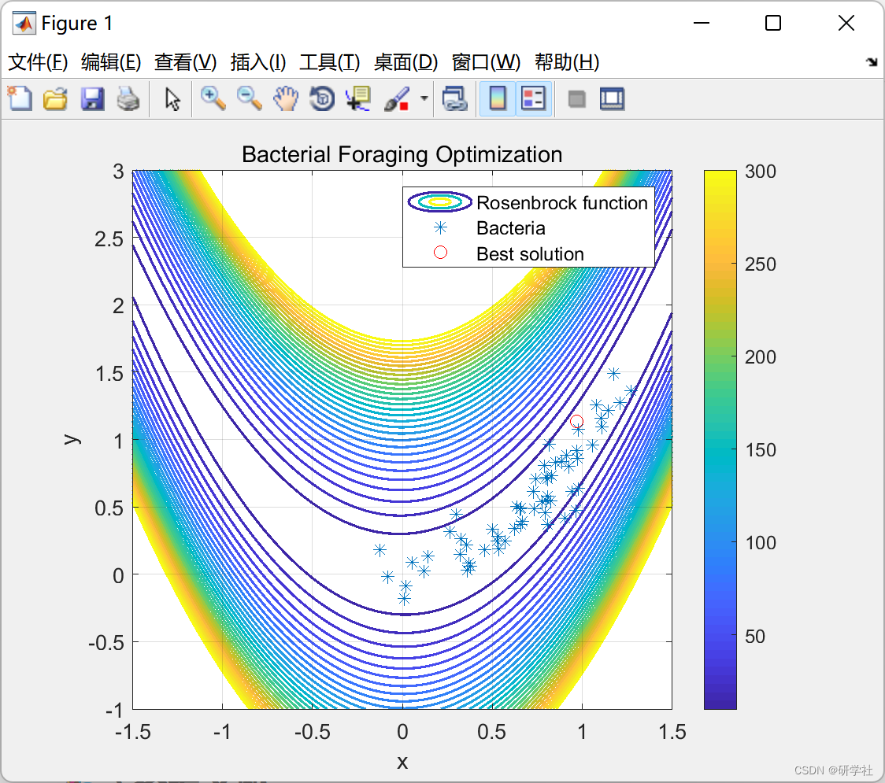
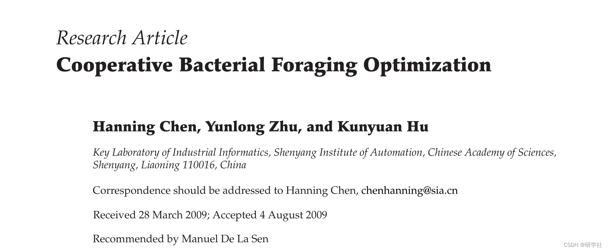

# Collaborative Bacterial Foraging Optimization Algorithm (Matlab Code Implementation)

Editing:

2. Running results editing
c(:,1)=0.05*ones(S,1); % the run length unit (the size of the step taken in each run or tumble)
% Initial positions
for m=1:S
    B(1,:,1,1,1)= 10*rand(S,1)';
    B(2,:,1,1,1)= 10*rand(S,1)';
end
%% Loops
% (2) Elimination-dispersal loop
for l = 1:Ned
% (3) Reproduction loop
for k = 1:Nre
% (4) Chemotaxis (swim/tumble) loop
for j=1:Nc
% (4.1) Chemotatic step
for i=1:S
% (4.2) Fitness function
J(i,j,k,l) = fitnessBFO(B(:,i,j,k,l));
% (4.3) Jlast
Jlast=J(i,j,k,l);
% (4.4) Tumble
Delta(:,i) = unifrnd(-1,1,n,1);
% (4.5) Move
B(:,i,j+1,k,l)=B(:,i,j,k,l)+c(i,k)*Delta(:,i)/sqrt(Delta(:,i)'*Delta(:,i));
% (4.6) New fitness function  
J(i,j+1,k,l)=fitnessBFO(B(:,i,j+1,k,l));  
% (4.7) Swimming  
m=0; % counter for swim length  
while m < Ns  
m=m+1;  
if J(i,j+1,k,l)<Jlast  
Jlast=J(i,j+1,k,l);  
B(:,i,j+1,k,l)=B(:,i,j+1,k,l)+c(i,k)*Delta(:,i)/sqrt(Delta(:,i)'*Delta(:,i)) ;  
J(i,j+1,k,l)=fitnessBFO(B(:,i,j+1,k,l));  
else  
m=Ns;  
end  
end  
J(i,j,k,l)=Jlast; %???  
end % (4.8) Next bacterium  
x = B(1,:,j,k,l);  
y = B(2,:,j,k,l);  
clf % clears figure  
run rose_fungraph.m  
plot(x,y,'*','markers',6) % plots figure  
axis([-1.5 1.5 -1 3]), axis square  
xlabel('x'); ylabel('y')  
title('Bacterial Foraging Optimization'); grid on  
legend('Rosenbrock function','Bacteria')  
pause(.01)  
hold on  
end % (5) if j < Nc, chemotaxis  
% (6) Reproduction  
% (6.1) Health  
Jhealth=sum(J(:,:,k,l),2);   % Set the health of each of the S bacteria  
[Jhealth,sortind]=sort(Jhealth);% Sorts bacteria in order of ascending values  
B(:,:,1,k+1,l)=B(:,sortind,Nc+1,k,l);  
c(:,k+1)=c(sortind,k);     % Keeps the chemotaxis parameters with each bacterium at the next generation  
% (6.2) Split the bacteria  
for i=1:Sr % Sr??  
B(:,i+Sr,1,k+1,l)=B(:,i,1,k+1,l); % The least fit do not reproduce, the most fit ones split into two identical copies  
c(i+Sr,k+1)=c(i,k+1);  
end  
end % (7) Loop to go to the next reproductive step  
% (8) Elimination-dispersal  
for m=1:S  
if Ped>rand % % Generate random number  
B(1,:,1,1,1)= 50*rand(S,1)';  
B(2,:,1,1,1)= .2*rand(S,1)';  
else  
B(:,m,1,1,l+1)=B(:,m,1,Nre+1,l); % Bacteria that are not dispersed  
end  
end  
end  
%% Results  
reproduction = J(:,1:Nc,Nre,Ned);  
[jlastreproduction,O] = min(reproduction,[],2); % min cost function for each bacterial  
[Y,I] = min(jlastreproduction);  
pbest = B(:,I,O(I,:),k,l);  
🎉3 References
🌈4 Matlab code implementation

## Images

<!-- PAYMENT_BLOCK -->

## Get this dataset

- Payment link (Stripe): [Buy now](https://buy.stripe.com/3cs8yP7sY87d0vu9AB)
- Payment QR code: 

<!-- /PAYMENT_BLOCK -->
